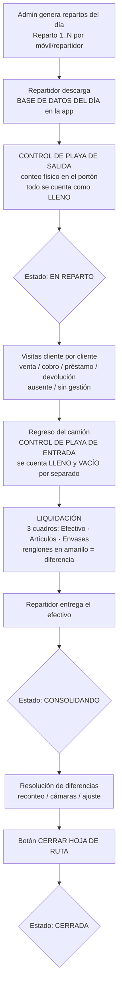
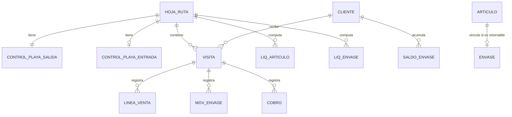
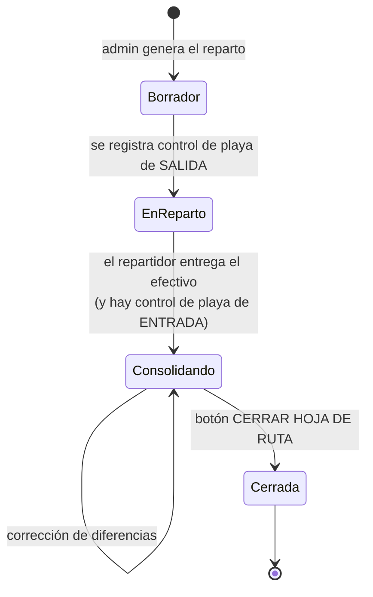

# D1 — Hoja de Ruta / Reparto / Liquidación
## Flujo funcional de punta a punta + mapeo técnico a Odoo 18 y App móvil

**Cliente:** INSA – Agua y Soda (Córdoba)
**Proyecto:** Implementación Odoo 18 Enterprise – Olpa Group
**Fuente:** Reunión "Insa – hoja de ruta" (18/07/2026, 29 min) — Santiago Alessandrini (Speaker 1), Nicolás Alessandrini (Speaker 2), equipo Olpa (Speaker 3)
**Destinatarios:** Milton Guzmán, Álvaro Busto, Lucas (desarrollo) — Matías Jaime (PO) — Andrés Urtega (PM)
**Alcance de este documento:** D1 (módulo Odoo) + insumo directo para D3 (app móvil de reparto)
**Licencia de entrega:** AGPL-3.0

> ⚠️ **Nota de transcripción:** donde el transcript dice *"control de plaga"* debe leerse **"control de playa"**. Es el conteo físico de mercadería en la playa/portón de INSA, a la salida y al regreso del camión. No tiene nada que ver con fumigación.

---

## 0. Resumen ejecutivo del flujo (una pantalla)



**Las tres verdades del negocio que hay que respetar sí o sí:**

1. **Todo producto retornable genera DOS liquidaciones simultáneas**: una del **artículo** (el contenido que se vende) y otra del **envase** (el continente que va y vuelve). Son dos cuadros con lógicas de cálculo distintas.
2. **La liquidación es una conciliación entre lo físico y lo registrado.** El sistema no "confía" en lo que cargó el repartidor: lo contrasta contra el conteo físico de playa. La diferencia es el KPI.
3. **Toda liquidación siempre se cierra.** No quedan hojas de ruta abiertas. Si hay diferencia y no se resuelve, se cierra igual con justificación. (Cita textual de Nicolás: *"todas las liquidaciones siempre se cierran"*.)

---

## 1. Glosario INSA → Odoo

| Término INSA | Qué significa | Equivalente / modelo Odoo propuesto |
|---|---|---|
| **Reparto** | Es a la vez el **número de ruta**, el **móvil** y el **turno del día**. "Reparto 1 del día miércoles". Hay ~15 repartos. | `insa.hoja.ruta` (registro cabecera) |
| **Hoja de ruta** | El documento/registro que agrupa todo el día de un reparto | mismo registro `insa.hoja.ruta` |
| **Control de playa** | Conteo físico de la mercadería en el portón de INSA. Hay uno de **salida** y uno de **entrada** | `insa.control.playa` (type = out / in) |
| **Liquidación** | Cierre y conciliación del reparto: efectivo + artículos + envases | pestañas computadas de `insa.hoja.ruta` |
| **Artículo** | El **contenido**: el agua, la soda. Lo que se vende y factura | `product.template` (tipo consumible/almacenable) |
| **Envase** | El **continente** retornable: bidón, sifón. Activo circulante de INSA, no se vende | `product.template` marcado `es_envase = True` |
| **Descartable** | Producto que se va y no vuelve (vasos, botellas descartables) | `product.template` con `es_retornable = False` |
| **Préstamo** | INSA deja envases de más en poder del cliente | movimiento de envase, signo negativo al retorno |
| **Devolución** | El cliente devuelve envases que tenía de más | movimiento de envase, signo positivo al retorno |
| **Consolidando** | Estado posterior a la entrega del efectivo, previo al cierre | `state = 'consolidando'` |
| **Alias** | Alias bancario **individual por cliente** (lo genera Banco Roela) usado para identificar automáticamente al pagador | `res.partner.alias_bancario` |
| **.insa** | Membresía de INSA con descuento (5% / 10%) | `product.pricelist` + flag en partner |
| **Teórico entregado** | Lo que el sistema calcula que se debería haber entregado | campo computado |
| **Registrado** | Lo que efectivamente cargaron los repartidores cliente por cliente | campo computado (suma de líneas) |

---

## 2. Modelo de datos conceptual



### 2.1 Modelos Odoo a crear

```
insa.hoja.ruta                 (cabecera del reparto del día)
insa.control.playa             (cabecera del conteo físico, tipo out/in)
insa.control.playa.line        (producto, cant_llenos, cant_vacios)
insa.hoja.ruta.visita          (una parada = un cliente)
insa.hoja.ruta.venta.line      (artículo + cantidad + precio)
insa.hoja.ruta.envase.mov      (envase + prestados + devueltos)
insa.hoja.ruta.cobro           (importe, medio de pago)
insa.liquidacion.articulo.line (computado, uno por artículo)
insa.liquidacion.envase.line   (computado, uno por envase)
insa.pedido.extra              (pedido inyectado por administración)
```

**Base OCA:** se extiende `fsm.route.dayroute` / `fsm.route.day` del repositorio **OCA/field-service rama 18.0**. La hoja de ruta hereda de ahí la relación ruta ↔ día ↔ vehículo ↔ operario y el ordenamiento de paradas. **No reinventar el ruteo.**

---

## 3. FLUJO DE PUNTA A PUNTA — detalle por etapa

### ETAPA 0 — Generación de los repartos del día (backoffice, Odoo)

**Quién:** administración de INSA
**Cuándo:** noche anterior / primera hora de la mañana

- Se generan N hojas de ruta, una por móvil/repartidor. Cada una nace con:
  - Número de reparto (secuencia)
  - Fecha
  - Repartidor asignado (ej: *"distribuidor número 9 = Matías Jaime"*)
  - Vehículo/móvil
  - **Listado de clientes ordenado** según la ruta fija semanal
- El orden importa: Nicolás lo señala explícitamente — *"la idea es que este listado de clientes esté ordenado y que lo vayan haciendo a medida que les va apareciendo"*. En la app se detecta si la ruta viene ordenada (secuencia creciente) porque eso es indicador de prolijidad del repartidor.

**Estado inicial:** `borrador` → pasa a `en_reparto` cuando se registra el control de playa de salida.

> 📌 **A relevar:** cómo se arma hoy la ruta fija semanal (frecuencia por cliente, día asignado, criterio geográfico). No se cubrió en esta reunión. Es prerequisito para automatizar la Etapa 0.

---

### ETAPA 1 — Descarga de la base de datos del día (App móvil)

Textual de la reunión:

> *"Los chicos están en la calle con su camión. Desde el aplicativo lo primero que tienen que hacer […] tienen que descargar la base de datos del día, seleccionar […] Entro a mi celular, pongo descargar la base de datos de hoy, 27 del 5, se descarga la base de datos, acto siguiente me deja cargar un control de playa."*

**Requisitos duros para D3:**

| Requisito | Detalle |
|---|---|
| **Descarga explícita** | Es un botón. El repartidor elige la fecha y baja el paquete. No es sync automático silencioso — hay que mantener esa UX porque es el ritual que ya tienen incorporado. |
| **Operación offline total** | El camión anda por barrios sin señal. Toda la jornada debe funcionar sin conectividad. |
| **Payload de la descarga** | Hoja de ruta + clientes ordenados + datos de contacto + geolocalización/foto de la casa + histórico de saldos + saldo de envases por cliente + lista de precios aplicable + catálogo de artículos + pedidos extra del día |
| **Bloqueo secuencial** | Hasta que no se descarga la base, **no se habilita el control de playa**. Hasta que no se cierra el control de playa de salida, no se habilitan las visitas. |
| **Sincronización de subida** | Por lotes, reintentable, idempotente (cada evento con UUID local para evitar duplicados al reintentar) |

---

### ETAPA 2 — Control de playa de SALIDA

**Quién:** el repartidor + control interno de INSA en el portón
**Dónde:** app móvil (y espejo en Odoo para el controlador)

**Regla de oro:**
> *"Cuando se fue, en el control de salida, solamente se cargaba todo lo que se veía en el camión y el sistema, al ser de salida, lo toma como que todo está lleno."*

- Se carga **una sola cantidad por producto** — sin distinguir lleno/vacío.
- El sistema asume **100% lleno** por definición de la operación de salida.
- Ejemplo real de la reunión: sale con **150 sifones**, **42 bidones de 15**, etc.

**Doble impacto automático:** al cargar un artículo retornable en el control de playa, el sistema genera automáticamente:
1. Una línea en la liquidación de **ARTÍCULOS** (el contenido)
2. Una línea en la liquidación de **ENVASES** (el continente)

Textual:
> *"Creando un artículo retornable, cuando yo hago un control de playa, por ejemplo en un sifón de litro y cuarto que es retornable, automáticamente el sistema me lo va a tirar en un sector que se llama artículo […] y al envase también me va a generar una liquidación sobre ese envase."*

**Implementación:** `product.template.es_retornable = True` + `envase_id` (M2O al product.template del envase). El onchange/compute del control de playa explota cada línea retornable en las dos tablas de liquidación.

Este es el **control de salida** que Santiago describe como *"rutinario, rápido — es como que vos cargaras cajas en una camioneta"*. La app tiene que reflejar eso: pantalla ágil, teclado numérico, sin fricción.

---

### ETAPA 3 — Reparto en calle: la visita cliente por cliente

Pantalla principal de la app (menú del reparto):

```
┌──────────────────────────────────────┐
│ REPARTO 1 — MIÉRCOLES 27/05         │
│ Estado: EN REPARTO                   │
│ Repartidor: [nombre]                 │
├──────────────────────────────────────┤
│ ▸ Cobro en efectivo                  │
│ ▸ Artículos y envases                │
│ ▸ Pedidos                            │
│ ▸ Indicadores                        │
│ ▸ Préstamos y devoluciones           │
│ ▸ Liquidación                        │
└──────────────────────────────────────┘
```

> ⚠️ **Restricción de gestión del cambio (no negociable):** los nombres de los segmentos, los estados y la iconografía tienen que replicar el sistema actual. Directiva de Santiago: *"primero el cambio de sistema, después el cambio cultural"*.

#### 3.1 Estados de visita e iconografía

El listado desplegable de clientes muestra íconos por cliente. **Son acumulables** — un mismo cliente puede tener varios.

| Ícono actual | Significado | Campo/flag |
|---|---|---|
| ✔️ Tilde | **Visitado** | `visitado = True` |
| 🛒 Carrito | **Hubo venta de artículos** | `tiene_venta = True` |
| ➡️ Flecha | **Hubo movimiento de envases** (préstamo o devolución) | `tiene_mov_envase = True` |
| ☕ Cafecito | **Ausente** — fui y no había nadie | `resultado = 'ausente'` |
| ❗ Exclamación en círculo | **Sin gestiones** — fui/hablé y no compró nada | `resultado = 'sin_gestion'` |
| 💲 Signo pesos | **Cobró** | `tiene_cobro = True` |

Aclaración de Nicolás sobre "sin gestiones": *"fui a tu casa y no me compraste nada […] o estuve hablando con vos por WhatsApp y me dijiste: no, por hoy paso, no necesito nada."* → **el canal WhatsApp también cuenta como gestión**. La app debe permitir marcar "sin gestión" sin haber ido físicamente.

#### 3.2 Ejemplos textuales de la reunión (usar como casos de test)

| Cliente | Qué pasó | Íconos |
|---|---|---|
| Galván, Brenda | Venta de 3 bidones de 20 con canilla. Sin cobro registrado (aún). | ✔️ 🛒 |
| Sosa, Mario | Venta de 2 bidones de 20 **+ préstamo de 2 bidones de 20** (el cliente necesitaba más envases o no estaba y pidió que se los dejen) | ✔️ 🛒 ➡️ |

#### 3.3 Qué se puede registrar en una visita

1. **Venta de artículos** → cantidad × artículo, precio tomado de la lista de precios del cliente
2. **Cobro** → **solo efectivo se liquida en la hoja de ruta** (ver Etapa 5.1)
3. **Movimiento de envases** → préstamo (+ envases al cliente) o devolución (− envases del cliente)
4. **Resultado sin transacción** → ausente / sin gestión

#### 3.4 Préstamos y devoluciones: la deuda de envases

Segmento propio en el menú. Lógica textual:

> *"Cuando un cliente tiene más envases de los que se le permite tener […] el sistema me dice: el cliente Banco de la Nación Argentina, con el artículo bidón de 20 común, tiene 7 envases que está debiendo. ¿Por qué? Porque su consumo normal y habitual, por ejemplo, es 3 y tiene 10 envases, me tiene que devolver 7."*

**Regla:**
```
envases_permitidos(cliente, envase) = consumo_habitual(cliente, envase)
deuda_envases = saldo_actual − envases_permitidos    (si > 0)
```

- El **saldo de envases por cliente** es persistente y transversal a todas las hojas de ruta. Santiago lo describe como una lista de almacén: *"Milton Guzmán tiene cuatro sodas, cuatro envases […] vos te vas moviendo con eso como si tuvieras una listita en el almacén"*.
- La app le muestra al repartidor, **antes de la visita**, los clientes con deuda de envases para que los reclame.
- **Implementación Odoo:** ubicación de stock por cliente (`stock.location` hijo de una ubicación virtual "Envases en clientes"). El saldo de envases es el `stock.quant` de esa ubicación. Esto da trazabilidad nativa y reportes de inventario sin modelos paralelos.

#### 3.5 Pedidos fuera de ruta

> *"No se utiliza mucho, pero sí cuando hay algún pedido que recibe la administración y que no corresponde a la hoja de ruta del repartidor del día, la administración lo coloca acá y ya le aparece al repartidor que lo tiene que visitar en algún momento del día."*

**Requisito:** la administración puede **inyectar una parada en una hoja de ruta ya en curso**. La app tiene que poder recibir esa inyección (push/pull al reconectar) e insertarla en el listado, marcada visualmente como pedido extra.

---

### ETAPA 4 — Regreso: Control de playa de ENTRADA

**El momento clave del proceso.** Es el conteo físico al que Speaker 3 se refirió como *"una auditoría rápida de si está todo por lo menos registrado"*, y Santiago confirmó: *"eso hace, hermano"*.

**Diferencia crítica con la salida:**

> *"Cuando nosotros hacemos una entrada, voy a poner cuánta mercadería llena y cuánta mercadería vacía veo de cada producto."*

| | Control de SALIDA | Control de ENTRADA |
|---|---|---|
| Campos por producto | 1 cantidad | **2 cantidades: LLENOS y VACÍOS** |
| Supuesto del sistema | todo lleno | lo que se cuenta |
| Alimenta | liquidación artículos (salida) + liquidación envases (salida) | liquidación artículos (entrada = **llenos**) + liquidación envases (entrada real = **llenos + vacíos**) |

**Contexto operativo real:** entre las 16:00 y las 17:00 llegan 6-7 camiones. El control de entrada es simultáneo y con presión de tiempo. La UI tiene que ser rapidísima: producto → llenos → vacíos → siguiente.

---

### ETAPA 5 — LIQUIDACIÓN

Tres cuadros, tres lógicas distintas.

#### 5.1 Cuadro COBRO EN EFECTIVO

> *"Acá cobros y efectivo maneja solamente el efectivo. Todas las transacciones que el repartidor puso 'cobro en efectivo' después las tiene que justificar con la entrega del dinero."*

- Suma de todos los cobros en efectivo registrados en las visitas
- Se contrasta contra el efectivo físico que entrega el repartidor
- **Las transferencias NO entran acá.** Van por el circuito "Bancos y cobros" (ver §6).

**Odoo:** diario de efectivo por repartidor (o por reparto). El cierre de la hoja de ruta genera el asiento/apunte contra la caja general.

#### 5.2 Cuadro ARTÍCULOS

**Columnas exactas del sistema actual:**

| Salida | Entrada | Teórico entregado | Registrado | Diferencia |
|---|---|---|---|---|

**Fórmulas:**

```
teorico_entregado = cant_salida − cant_entrada_llenos + reutilizable
registrado        = Σ (ventas cargadas en las visitas de este reparto)
diferencia        = teorico_entregado − registrado
```

> **`reutilizable`**: el tooltip del sistema actual dice *"control de salida menos cantidad de entrada más reutilizable"*. Santiago y Nicolás confirman que **INSA no lo usa** (queda siempre en 0). **Decisión de diseño:** modelarlo como campo existente pero oculto/en 0 por defecto, para no arrastrar complejidad muerta. Documentarlo como gap aceptado.

**Casos de test tomados literalmente de la reunión (Reparto 2, martes):**

| Artículo | Salida | Entrada | Teórico entregado | Registrado | Dif. | Resultado |
|---|---|---|---|---|---|---|
| Sifón | 150 | 63 | 87 | 87 | **0** | OK (blanco) |
| Bidón de 15 | 42 | 9 | 33 | 27 | **6** | ⚠️ Diferencia (amarillo) |

**Regla visual (no negociable):**
> *"Si hay renglones pintados en amarillo, quiere decir que hay diferencias. Ese es nuestro filtro."*

→ El renglón con `diferencia != 0` se pinta de **amarillo**. Y debe existir un **filtro "solo diferencias"** en la vista lista.

#### 5.3 Cuadro ENVASES

**Lógica distinta.** Textual:

> *"La salida, como salida, va a tomar con lo que salió en primera medida del repartidor. Y ahí ya va a restar de eso todos los préstamos […] y las devoluciones que recibió por parte de los clientes. […] La entrada teórica vendría siendo la salida menos los préstamos más las devoluciones. Y la entrada real vendría siendo efectivamente lo que yo dije en el control de ruta de entrada […] la cantidad de envases vacíos y llenos que yo tengo."*

**Fórmulas:**

```
entrada_teorica = cant_salida − préstamos + devoluciones
entrada_real    = entrada_llenos + entrada_vacíos     ← del control de playa de entrada
diferencia      = entrada_teorica − entrada_real
```

**Por qué la venta normal no mueve el saldo de envases:** entrego un bidón lleno y me llevo el vacío → el envase vuelve. El saldo solo se altera cuando hay **préstamo** (queda de menos) o **devolución** (vuelve de más). Por eso la fórmula no resta las ventas.

**Caso de test de la reunión:** al cliente Sosa se le prestaron 2 bidones de 20 → en el cuadro de envases del reparto aparecen esos 2 bidones como préstamo, bajando la entrada teórica en 2.

Misma regla de amarillo. `diferencia == 0` → conciliado.

#### 5.4 Otros segmentos del menú de liquidación

- **Pedidos** — pedidos extra inyectados (§3.5)
- **Indicadores** — mencionados de pasada (*"tenemos algunos indicadores que también después los podemos ver"*). **No relevados.** → pendiente de sesión específica.
- **Préstamos y devoluciones** — vista consolidada de los movimientos de envase del reparto

---

### ETAPA 6 — Estado CONSOLIDANDO y resolución de diferencias

**Trigger del cambio de estado:**
> *"Consolidando se da cuando yo entrego el dinero, el repartidor entrega lo que es el dinero en efectivo."*

En este estado se investigan las diferencias. Las causas típicas que dio Nicolás — usar como texto de ayuda en el módulo:

> *"Cuando terminan de hacer los controles de playa, puede que en alguno de todos estos artículos les falte un bidón o una soda. Es lo normal, porque se olvidaron de anotarlo, o porque ya saben que en tal cliente tenían que anotar una soda de más y lo dejaron para el último."*

Y el caso extremo del ejemplo real:
> *"Quizá hubo un error que hay que mirar por las cámaras porque el repartidor estima que salió con menos mercadería porque justo también le faltan los envases."*

**Requisitos:**

| # | Requisito |
|---|---|
| R-6.1 | Toda diferencia debe poder resolverse **corrigiendo el registro** (agregar la venta que faltaba anotar) o **corrigiendo el conteo** (reconteo de playa) |
| R-6.2 | Toda corrección posterior al cierre del control de playa queda **auditada**: quién, cuándo, valor anterior, valor nuevo |
| R-6.3 | Cierre con diferencia ≠ 0: **bloqueado para el usuario común**, habilitado para supervisor con **motivo escrito obligatorio** que queda registrado |
| R-6.4 | La diferencia no resuelta genera un **ajuste de inventario** con contrapartida a una cuenta de faltantes/mermas |

---

### ETAPA 7 — Cerrar hoja de ruta

> *"Cuando la persona terminó de solucionar estos problemas, hay un botóncito que se llama cerrar hoja de ruta y ese es el momento en que termina de cambiarse el estado."*

Al cerrar:
1. Se confirman los movimientos de stock (salida de mercadería, retorno de envases)
2. Se actualizan los saldos de envases por cliente
3. Se impacta el efectivo en el diario de caja
4. Se generan (o quedan listos para generar) los comprobantes de venta
5. El registro queda **bloqueado** (readonly, sin edición posterior)

---

## 4. Máquina de estados de la hoja de ruta



**Los tres estadios son textuales de la reunión** — *"primero estábamos en reparto, después pasamos a consolidando […] esos son los tres estadios por los cuales sufre una liquidación desde que comienza hasta que termina"*.

| Estado | Etiqueta en pantalla (usar EXACTA) | Editable |
|---|---|---|
| `borrador` | Borrador | sí |
| `en_reparto` | **En reparto** | sí (desde app) |
| `consolidando` | **Consolidando** | sí (solo backoffice) |
| `cerrada` | **Cerrada** | no |

> El estado `borrador` es agregado nuestro (Odoo lo necesita para el armado previo). **A validar con INSA** si se muestra o se colapsa dentro de "En reparto".

---

## 5. Artículos, envases y precios

### 5.1 Estructura de productos

Santiago lo definió así:
> *"Tenemos artículos líquidos, el agua en sus distintas variables, y artículos de envases retornables, como la Coca-Cola de los kioscos, y envases descartables. Los envases descartables es más fácil: vos vas a comprar una Coca al kiosco y te fuiste. Y el envase retornable sí tiene que haber un stock."*

**Tres familias:**

| Familia | Retornable | Genera línea de envase | Ejemplo |
|---|---|---|---|
| Líquido en envase retornable | ✅ | ✅ | Sifón 1¼ L, bidón 20 común, bidón 20 con canilla, bidón 15 |
| Descartable | ❌ | ❌ | vasos, bidones descartables |
| Envase (el continente) | — | — | bidón 20 vacío, sifón vacío |

**Modelado (decisión ya tomada — mantener):** **dos `product.template` vinculados**.
- `producto_venta` (el artículo/contenido) → `es_retornable = True`, `envase_id = producto_envase`
- `producto_envase` (el envase) → `es_envase = True`, no facturable, controlado por stock en ubicaciones por cliente

**Catálogo confirmado en la reunión (parcial):** sifón, bidón de 20 común, bidón de 20 con canilla, bidón de 15. → **falta el catálogo completo.**

### 5.2 Listas de precios

Santiago describió al menos cuatro escenarios:

1. **Lista matriz** — precio estándar minorista (*"tengo para Mati, Álvaro, Nico y Milton, tengo todo lo mismo"*)
2. **Lista distribuidor/revendedor** — *"viene el jardinero que vino acá a mi casa y el jardinero también reparte agua, entonces yo tengo un precio para el jardinero por agua para ser distribuida"*
3. **Lista membresía .insa** — *"si vos sos cliente .insa […] tiene un 10% de descuento, un 5% de descuento, entonces tiene que haber otra lista"*
4. Implícito: precios diferenciados **B2B** (empresas, comercios, sector público)

**Odoo:** `product.pricelist` estándar + asignación por partner. La membresía `.insa` se resuelve como pricelist con regla de descuento porcentual sobre la matriz, más un flag/etiqueta en `res.partner`.

> 📌 **A definir con INSA:** los porcentajes exactos (¿5% y 10% son dos niveles de membresía o dos productos distintos?), la vigencia, y si `.insa` tiene una cuota que hay que facturar.

---

## 6. Cobros: el circuito paralelo de transferencias

**Esto NO es parte de la liquidación de la hoja de ruta, pero condiciona el diseño.**

Textual:
> *"Prácticamente el 80, el 90% de nuestras transferencias son automáticas y se hacen una vez al día. Se importan al sistema las transferencias del día anterior que recibió el banco, se plasman en el sistema, se hace un cruzamiento de datos por ese alias individual que tiene cada cliente e impactan en el cliente. Por eso no se van a ver reflejados acá en esta parte de liquidación, porque van por otro lado, que es bancos y cobros."*

Y Santiago sobre el mecanismo:
> *"Como imputa directamente a la cuenta que yo tengo generada […] que dice que si me pagan con este alias, me está pagando Milton Guzmán, ya no tengo que estar constatando todo el tiempo."*

**Requisitos que salen de acá:**

| # | Requisito | Módulo |
|---|---|---|
| C-1 | Cada cliente tiene un **alias bancario individual** generado por Banco Roela. Campo obligatorio en `res.partner`. | Contactos |
| C-2 | Importación diaria del extracto bancario (día anterior) | Contabilidad |
| C-3 | **Conciliación automática por alias** → el alias identifica unívocamente al cliente pagador | Contabilidad |
| C-4 | INSA tiene **una sola cuenta bancaria** para toda la empresa (Banco Roela) + Mercado Pago | Contabilidad |
| C-5 | La liquidación de la hoja de ruta **solo maneja efectivo** | D1 |

> 📌 **A relevar:** formato de archivo del extracto de Banco Roela (¿CBU/alias en el detalle? ¿CSV, TXT, MT940?) y si hay API. Determina si C-2/C-3 es automático o semi-manual.

---

## 7. Especificación técnica Odoo 18 — campos por modelo

### 7.1 `insa.hoja.ruta`

| Campo | Tipo | Notas |
|---|---|---|
| `name` | Char | Secuencia: `REP/2026/0001` |
| `numero_reparto` | Integer | El "Reparto 1", "Reparto 2" que usa INSA |
| `fecha` | Date | |
| `repartidor_id` | M2O `hr.employee` / `res.users` | *"distribuidor número 9"* → agregar `codigo_distribuidor` |
| `vehiculo_id` | M2O `fleet.vehicle` | Enlaza con el módulo Flota ya migrado |
| `state` | Selection | `borrador / en_reparto / consolidando / cerrada` |
| `control_salida_id` | M2O `insa.control.playa` | |
| `control_entrada_id` | M2O `insa.control.playa` | |
| `visita_ids` | O2M | |
| `liq_articulo_ids` | O2M computado | |
| `liq_envase_ids` | O2M computado | |
| `total_efectivo_registrado` | Monetary computed | Σ cobros efectivo |
| `total_efectivo_entregado` | Monetary | Carga manual al consolidar |
| `dif_efectivo` | Monetary computed | |
| `tiene_diferencias` | Boolean computed | `any(dif != 0)` en artículos o envases |
| `motivo_cierre_con_diferencia` | Text | Obligatorio si se cierra con diferencia |
| `usuario_override_id` | M2O `res.users` | Quién autorizó el cierre forzado |

### 7.2 `insa.control.playa`

| Campo | Tipo | Notas |
|---|---|---|
| `hoja_ruta_id` | M2O | |
| `tipo` | Selection | `salida` / `entrada` |
| `line_ids` | O2M | |
| `fecha_hora` | Datetime | |
| `responsable_id` | M2O | quién controló en el portón |

### 7.3 `insa.control.playa.line`

| Campo | Tipo | Notas |
|---|---|---|
| `product_id` | M2O `product.product` | |
| `cant_llenos` | Float | En salida = la cantidad total contada |
| `cant_vacios` | Float | **Solo visible/editable si `tipo = entrada`** |

### 7.4 `insa.liquidacion.articulo.line` (computado)

| Campo | Fórmula |
|---|---|
| `cant_salida` | control salida → `cant_llenos` |
| `cant_entrada` | control entrada → `cant_llenos` |
| `reutilizable` | 0 (oculto, INSA no lo usa) |
| `teorico_entregado` | `cant_salida - cant_entrada + reutilizable` |
| `registrado` | Σ líneas de venta del reparto |
| `diferencia` | `teorico_entregado - registrado` |

### 7.5 `insa.liquidacion.envase.line` (computado)

| Campo | Fórmula |
|---|---|
| `cant_salida` | control salida del envase asociado |
| `prestamos` | Σ movimientos préstamo del reparto |
| `devoluciones` | Σ movimientos devolución del reparto |
| `entrada_teorica` | `cant_salida - prestamos + devoluciones` |
| `entrada_real` | control entrada → `cant_llenos + cant_vacios` |
| `diferencia` | `entrada_teorica - entrada_real` |

### 7.6 Extensión `res.partner`

| Campo | Tipo | Notas |
|---|---|---|
| `alias_bancario` | Char | Único. Clave de conciliación automática |
| `consumo_habitual_ids` | O2M | producto ↔ cantidad habitual |
| `envase_location_id` | M2O `stock.location` | Ubicación de stock propia para envases en su poder |
| `es_miembro_insa` | Boolean | Membresía .insa |
| `foto_domicilio` | Binary/Image | Santiago: *"sé hasta la foto de tu casa"* — ya existe en el sistema actual |

### 7.7 Extensión `product.template`

| Campo | Tipo |
|---|---|
| `es_retornable` | Boolean |
| `es_envase` | Boolean |
| `envase_id` | M2O `product.template` (el envase asociado) |

### 7.8 Vistas

- **Lista de hojas de ruta** con decoración por estado + filtro **"Con diferencias"**
- **Formulario** con statusbar de 3 (o 4) estados en la barra superior
- **Notebook** con pestañas que replican los segmentos actuales: *Cobro en efectivo · Artículos y envases · Pedidos · Indicadores · Préstamos y devoluciones*
- **Renglón amarillo:** `decoration-warning="diferencia != 0"` en las list views de liquidación
- **Vista desplegable de visitas** con los íconos por cliente (widget custom o campos booleanos con `widget="boolean_toggle"` + iconografía propia)

---

## 8. Especificación de la App móvil (D3)

### 8.1 Mapa de pantallas

```
1. Login
2. Descargar base de datos del día  ← paso obligatorio y explícito
3. Menú del reparto (estado, número, repartidor)
   ├── 3.1 Control de playa de SALIDA   [bloquea el resto hasta completarse]
   ├── 3.2 Listado de clientes ordenado
   │      └── Detalle de visita
   │            ├── Venta de artículos
   │            ├── Cobro (efectivo / transferencia informada)
   │            ├── Movimiento de envases (préstamo / devolución)
   │            └── Marcar ausente / sin gestión
   ├── 3.3 Préstamos y devoluciones (clientes con deuda de envases)
   ├── 3.4 Pedidos extra (inyectados por administración)
   ├── 3.5 Control de playa de ENTRADA  [llenos + vacíos]
   └── 3.6 Liquidación (solo lectura para el repartidor)
4. Sincronizar / subir jornada
```

### 8.2 Requisitos no funcionales

| # | Requisito |
|---|---|
| A-1 | **Offline-first.** SQLite local. Toda la jornada operable sin señal. |
| A-2 | **Idempotencia.** Cada evento con UUID generado en el dispositivo; el backend hace search-before-create. |
| A-3 | **Sync incremental y reintentable.** Si se corta a mitad, retoma sin duplicar. |
| A-4 | **Resistente a batería/cierre de app.** Persistencia inmediata de cada evento, no al final. |
| A-5 | **UI de conteo rápida.** Teclado numérico grande, avance por producto. Los controles de playa son bajo presión de tiempo. |
| A-6 | **Sin capacitación previa.** La curva de aprendizaje del repartidor tiene que ser cero: mismos nombres, mismos íconos, mismo orden que la app actual. |
| A-7 | Geolocalización de la visita (opcional, a confirmar si la app actual la usa) |

> 📌 **Decisión técnica pendiente:** stack de la app (PWA vs. nativa vs. Odoo mobile). Recomendación inicial: **PWA con service worker + IndexedDB**, sincronizando contra Odoo por JSON-RPC. Justificación: no requiere store, actualización instantánea, y el hardware lo provee el cliente (supuesto del Acta). **A validar con Andrés y Matías.**

---

## 9. Reglas de negocio consolidadas (checklist de implementación)

| # | Regla | Origen |
|---|---|---|
| RN-01 | No se puede iniciar el reparto sin control de playa de salida cerrado | 06:19 |
| RN-02 | El control de salida asume todo LLENO, sin campo de vacíos | 13:54 |
| RN-03 | El control de entrada exige LLENOS y VACÍOS por separado | 14:48 |
| RN-04 | Un artículo retornable genera automáticamente línea de artículo Y línea de envase | 09:37 |
| RN-05 | `teórico entregado = salida − entrada + reutilizable` (reutilizable = 0 en INSA) | 15:43 |
| RN-06 | `diferencia artículo = teórico entregado − registrado` | 15:53 |
| RN-07 | `entrada teórica envase = salida − préstamos + devoluciones` | 21:13 |
| RN-08 | `entrada real envase = llenos + vacíos del control de entrada` | 21:13 |
| RN-09 | Renglón amarillo si diferencia ≠ 0, con filtro dedicado | 16:18 / 17:41 |
| RN-10 | La liquidación de la hoja de ruta solo contempla efectivo | 19:02 |
| RN-11 | Las transferencias se concilian por alias individual del cliente, fuera de la hoja de ruta | 19:02 |
| RN-12 | Estados: En reparto → Consolidando → Cerrada | 23:19 |
| RN-13 | "Consolidando" se dispara con la entrega del efectivo | 19:02 |
| RN-14 | **Toda liquidación siempre se cierra** (con override + motivo si hay diferencia) | 19:02 |
| RN-15 | El saldo de envases por cliente es persistente y transversal a los repartos | 01:07 |
| RN-16 | El cliente tiene un tope de envases = su consumo habitual; el excedente es deuda | 09:37 |
| RN-17 | La administración puede inyectar pedidos extra a una ruta en curso | 08:29 |
| RN-18 | "Sin gestión" puede originarse en una conversación de WhatsApp, sin visita física | 12:56 |
| RN-19 | Íconos por visita acumulables (visitado, venta, envase, ausente, sin gestión, cobro) | 11:53 |
| RN-20 | Al menos 3 listas de precios: matriz, distribuidor, membresía .insa | 01:07 |

---

## 10. Casos de test obligatorios (extraídos textualmente de la reunión)

### CT-01 — Liquidación de artículos sin diferencia
Salida 150 sifones · Entrada 63 · Teórico 87 · Registrado 87 → **Diferencia 0, renglón blanco**

### CT-02 — Liquidación de artículos con diferencia
Salida 42 bidones de 15 · Entrada 9 · Teórico 33 · Registrado 27 → **Diferencia 6, renglón amarillo**

### CT-03 — Venta simple
Galván Brenda: 3 bidones de 20 con canilla, sin cobro → íconos ✔️🛒, sin ícono de envase ni de pesos

### CT-04 — Venta + préstamo
Sosa Mario: 2 bidones de 20 vendidos + 2 bidones de 20 prestados → íconos ✔️🛒➡️; el cuadro de envases baja la entrada teórica en 2

### CT-05 — Deuda de envases
Banco de la Nación Argentina · bidón de 20 común · consumo habitual 3 · saldo 10 → **deuda = 7**, aparece en "Préstamos y devoluciones"

### CT-06 — Control de salida y entrada del ejemplo de Santiago
Distribuidor 9 (Matías Jaime): sale con 20 envases llenos, vuelve con 15 llenos → vendió 5 · de esos, trae 3 vacíos y 2 no → **2 envases quedaron prestados**, que hay que imputar al cliente correspondiente (Nicolás Alessandrini en el ejemplo) para que su saldo suba en 2

### CT-07 — Cierre con diferencia
Reparto con diferencia de 6 bidones que no se resuelve → usuario común **bloqueado**; supervisor cierra con motivo escrito → queda registrado el motivo, el usuario y la fecha; se genera ajuste de inventario

---

## 11. Vacíos de información — pendientes de relevamiento

| # | Tema | Por qué importa | Cómo se cierra |
|---|---|---|---|
| V-01 | **Indicadores** del menú de liquidación | Nicolás los mencionó sin abrirlos | Sesión de pantalla específica |
| V-02 | Armado de la **ruta fija semanal** (frecuencias, día por cliente, criterio geográfico) | Es la Etapa 0 completa, hoy sin relevar | Sesión con administración |
| V-03 | **Catálogo completo de artículos y envases** | Base de todo el modelado de productos | Export del sistema actual |
| V-04 | **Porcentajes y reglas de la membresía .insa** | Definición de pricelists | Santiago |
| V-05 | **Formato del extracto de Banco Roela** | Determina si la conciliación por alias es automática | Administración / banco |
| V-06 | Manejo de **fiados y saldos** (mencionados en el Acta, no en esta reunión) | Impacta cobranza y cuenta corriente | Sesión de "Bancos y cobros" |
| V-07 | Pantallas de **clientes** y **precios** del sistema actual | Nicolás las ofreció explícitamente al final | Próxima reunión |
| V-08 | ¿La app actual usa **geolocalización** o firma del cliente? | Define alcance de D3 | Visita a planta |
| V-09 | Comportamiento cuando un **cliente no está en la ruta** pero el repartidor le vende igual | Caso borde frecuente en el rubro | INSA |
| V-10 | ¿Se factura en el momento de la entrega o después? | Define integración con AFIP | INSA / Contabilidad |

---

## 12. ACCIÓN INMEDIATA — visita a planta

Santiago lo ofreció de forma explícita y reiterada. **Es la vía más rápida para cerrar la mitad de los vacíos de la §11.**

> *"Vénganse un día a la fábrica a ver esta parte y la van a ver en vivo […] con que se queden no más de 40 minutos un día entre las 4 y las 5 de la tarde, tengo 6, 7 camiones para que ustedes al lado nuestro puedan ver la dinámica."*

**Propuesta de agenda para Álvaro y Milton (2 visitas):**

| Visita | Horario | Qué observar |
|---|---|---|
| **Tarde** | 16:00–17:00 | Llegada de 6-7 camiones · control de playa de entrada en vivo · conteo llenos/vacíos · liquidación · entrega de efectivo. Santiago se ofrece a mostrar **el reparto más prolijo y el más desprolijo** (~15 repartos, él sabe quiénes son). |
| **Mañana** | a coordinar | Control de salida · atención telefónica de clientes · uso del sistema por administración · resolución de casos con historial de cuenta |

**Consigna que dio Santiago para el relevamiento:** *"sean escuetos, no expliquen sus necesidades, sino expliquen la dinámica del día"*. Es decir: **relevar el proceso tal cual es hoy, no la wishlist.** Las mejoras van en una segunda instancia.

---

## 13. Riesgos específicos de D1 (complementan R1 y R4 del Acta)

| # | Riesgo | Mitigación |
|---|---|---|
| D1-R1 | La app actual tiene una UX muy afinada por años de uso. Cualquier fricción nueva se lee como retroceso. | Replicar nombres, íconos y orden exactos. Validar con repartidores reales antes de programar, no después. |
| D1-R2 | La operación offline es un requisito duro y suele subestimarse. | Diseñar sync e idempotencia desde el día 1, no como parche. |
| D1-R3 | El conteo de playa es rápido y bajo presión (6-7 camiones simultáneos). Una UI lenta rompe la operación. | Prototipo de la pantalla de conteo y prueba cronometrada en planta. |
| D1-R4 | El saldo de envases por cliente arrastra el histórico completo. Migrarlo mal invalida todo el módulo. | Inventario físico + saldo inicial congelado por cliente antes de la puesta en marcha (ya previsto en R7 del Acta). |
| D1-R5 | Aprobaciones "de a poquito" acordadas con Andrés → riesgo de alcance móvil. | Cada aprobación parcial se documenta con firma de ambos co-sponsors y se cierra formalmente. |

---

## 14. Próximos pasos sugeridos

1. **Validar este documento con Nicolás y Santiago** — es el entregable de aprobación parcial que ellos mismos propusieron (*"aprobaciones parciales o de a poquito para seguir avanzando"*).
2. **Agendar las dos visitas a planta** (tarde y mañana) para Álvaro y Milton.
3. **Pedir el export del catálogo de artículos, envases y clientes** del sistema actual.
4. **Sesión específica** sobre: Clientes · Precios · Indicadores (Nicolás ya se ofreció).
5. **Cerrar el alcance de D1 por escrito** antes de arrancar el desarrollo (mitigación R4 del Acta).
6. **Prototipo navegable** de las 3 pantallas críticas (control de playa, visita, liquidación) para validar con repartidores reales.
